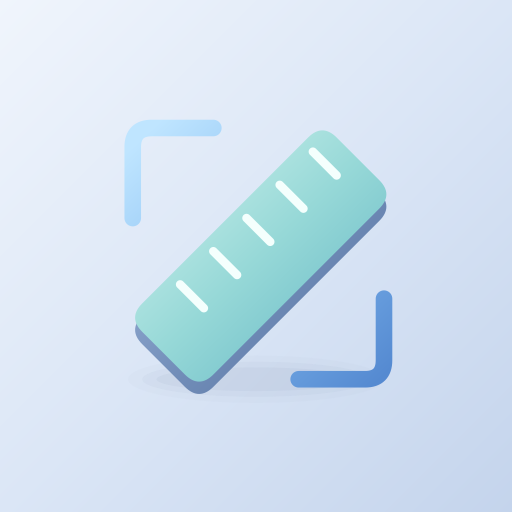

# AR Measure | متر واقعیت افزوده

[دریافت آخرین نسخه / Download latest](https://github.com/cinaasadpour-hash/ar-measure/releases/latest)

## فارسی

متر واقعیت افزوده، دوربین گوشی را به ابزاری برای تخمین ابعاد محیط تبدیل می‌کند. روی دستگاه‌های سازگار با ARCore، نقاط را روی سطوح شناسایی‌شده ثبت کنید و فاصله، ارتفاع، زاویه، مساحت یا حجم جعبه را برآورد کنید.

اندازه‌گیری‌های خود را در پروژه‌ها ذخیره کنید و گزارش PDF، جدول CSV یا دادهٔ JSON بگیرید. حالت اندازه‌گیری روی عکس نیز با یک مرجع دارای طول معلوم در دسترس است. رابط فارسی و انگلیسی و تم روشن و تیره ارائه شده‌اند.

اندازه‌ها تخمین نوری‌اند و به نور، بافت سطح و ردیابی وابسته‌اند؛ برای کار دقیق با ابزار فیزیکی مقایسه شوند. حالت AR به گوشی سازگار و خدمات AR گوگل نیاز دارد. در حالت عکس، مرجع و هدف باید هم‌صفحه باشند.

این برنامه دارای تبلیغات است.

### شروع کار

به دوربین اجازه دسترسی بدهید. در دستگاه سازگار با AR، سطح را اسکن و نقاط اندازه‌گیری را مشخص کنید. اندازه‌ها تقریبی‌اند و جای ابزار اندازه‌گیری دقیق را نمی‌گیرند.

### تبلیغات

بنر همسان در پروژه‌ها و تنظیمات، خارج از دوربین. نبود تبلیغ مانع استفاده از برنامه نمی‌شود.

## English

AR Measure turns your phone camera into a tool for estimating dimensions. On ARCore-compatible devices, place points on detected surfaces to estimate distance, height, angles, area or box volume.

Save measurements in projects and export PDF reports, CSV tables or JSON data. A reference-photo mode lets you measure an image using an object with a known length. Persian and English interfaces and light and dark themes are available.

Measurements are optical estimates affected by lighting, surface texture and tracking. Verify precise work with physical tools. AR mode requires a compatible phone and Google Play Services for AR. In photo mode, the reference and target must lie on the same plane.

This app contains advertising.

### Getting started

Allow camera access. On a compatible AR device, scan a surface and place measurement points. Measurements are approximate and do not replace precision tools.

### Advertising

Native banner in Projects and Settings, outside the camera. An unavailable ad does not block ordinary use.

## Download and updates | دریافت و به‌روزرسانی

Android APK, version **1.0.3**. Package: `com.sinatools.armeasure`.
For updates, install over the existing app to preserve its local data. Do not uninstall first.

برای حفظ اطلاعات، نسخه جدید را روی نسخه قبلی نصب کنید؛ ابتدا برنامه را حذف نکنید.

[Privacy / حریم خصوصی](PRIVACY.md)

This repository distributes the signed app and user guide. Private signing keys and local build credentials are not published.
