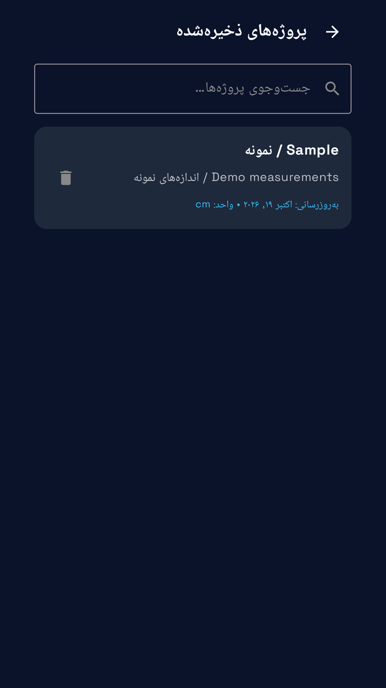
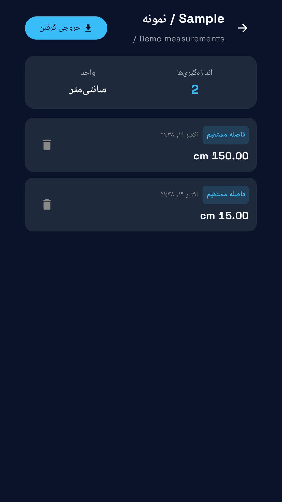
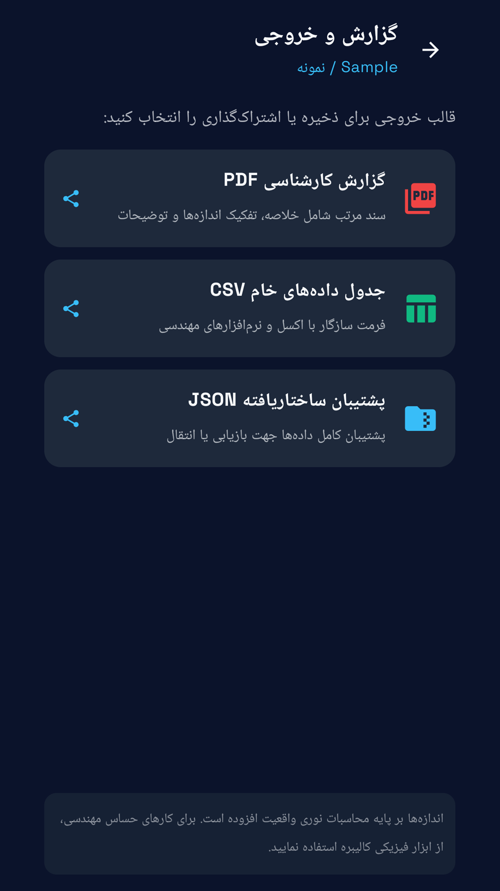
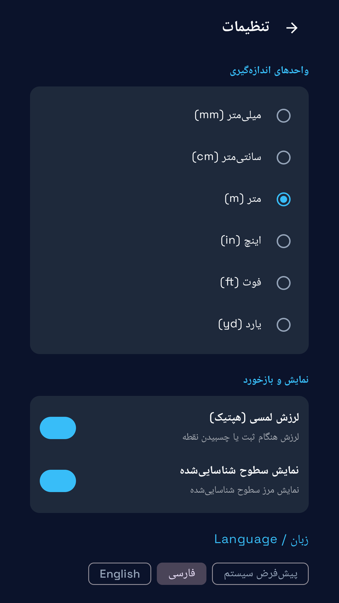
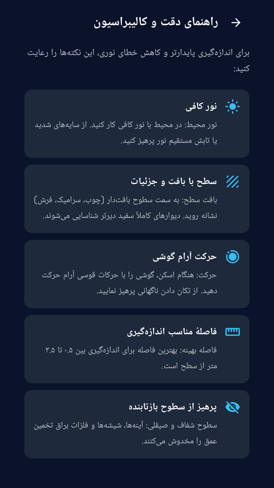
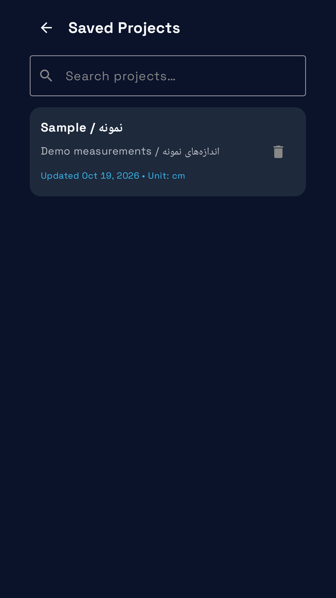
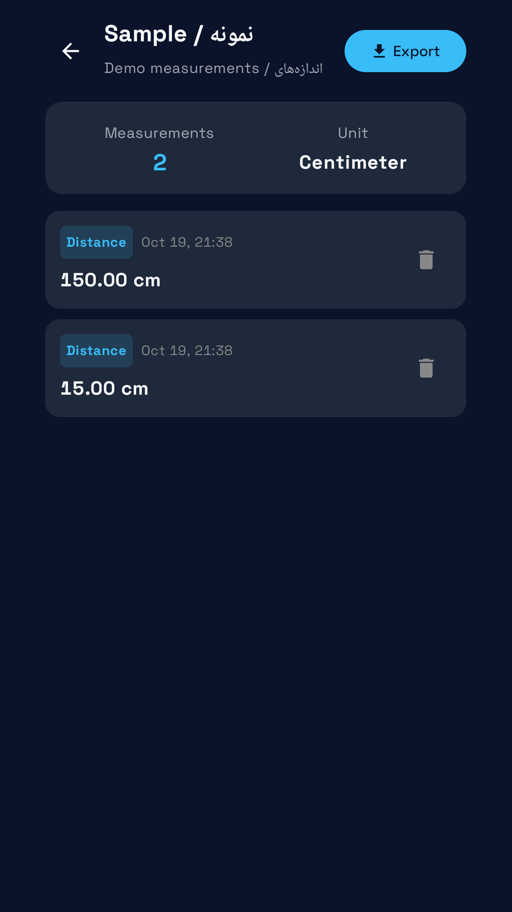
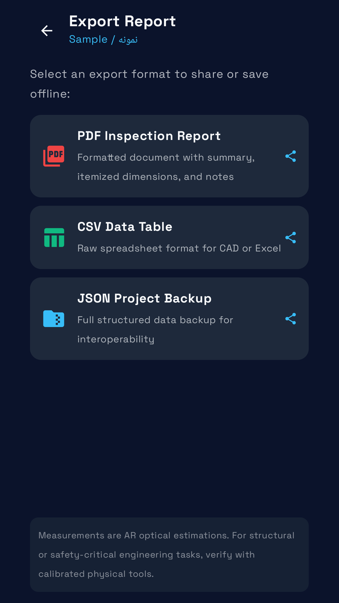
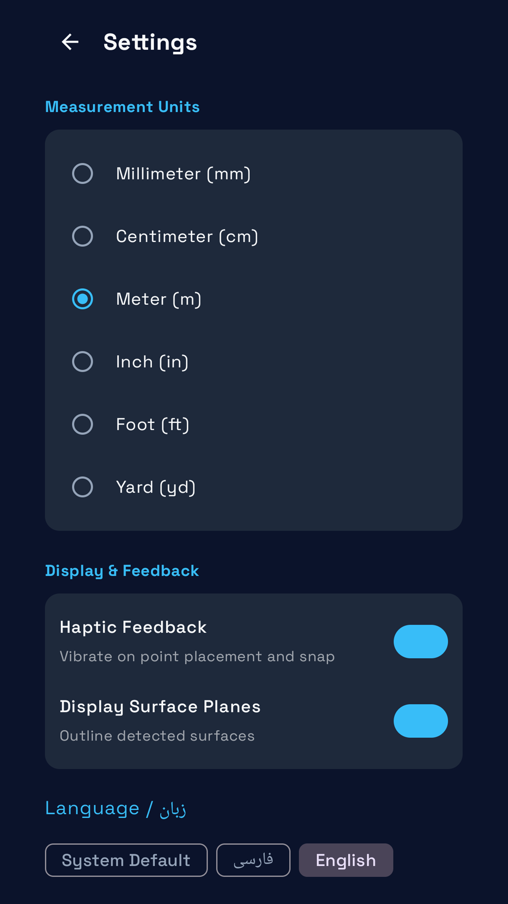
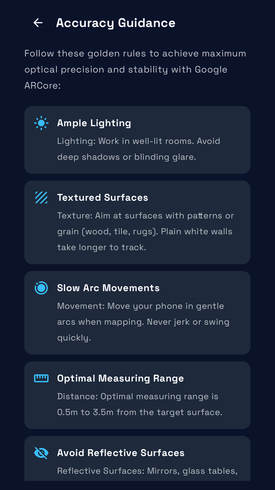

# AR Measure | متر واقعیت افزوده

**Experimental release: physical measurement accuracy has not been validated. Do not treat sample measurements as accuracy evidence. / نسخهٔ آزمایشی: دقت اندازه‌گیری فیزیکی هنوز تأیید نشده است.**

[Download / دریافت APK](https://github.com/cinaasadpour-hash/ar-measure/releases/tag/v1.0.4)

Package: `com.sinatools.armeasure` · Version: **1.0.4** · Version code: **5**

## فارسی

اندازه‌گیری با واقعیت افزوده، مقیاس‌گذاری عکس و مدیریت پروژه‌های اندازه‌گیری.

با متر واقعیت افزوده، از ابزارهای اندازه‌گیری دوربین و مقیاس‌گذاری عکس استفاده کنید و اندازه‌ها را در پروژه‌های مرتب نگه دارید.

• اندازه‌گیری فاصله، ارتفاع، مسیر و شکل‌های پشتیبانی‌شده برای مساحت و حجم
• انتخاب نقطه با هدف‌گیر وسط صفحه یا لمس تصویر دوربین
• استفاده از سطح و اطلاعات عمق پشتیبانی‌شده توسط ARCore؛ نقطه باید واقعاً روی سطح موردنظر باشد
• اندازه‌گیری روی عکس با طول مرجع معلوم و نقاط هم‌صفحه
• ذخیره پروژه و خروجی PDF، CSV و JSON
• انتخاب واحد، زبان و ظاهر برنامه

اندازه‌های AR تقریبی‌اند. سازگاری گوشی، نور، بافت سطح، حرکت دوربین و فاصله روی نتیجه اثر می‌گذارند. دیوار ساده، سطح براق و جسم متحرک ممکن است درست اندازه‌گیری نشوند. پیش از نقطه‌گذاری، گوشی را آرام در کنار سطح جابه‌جا کنید. هدف‌گیر سبز نشانه وجود نقطه قابل استفاده است و دقت عدد را تضمین نمی‌کند. اندازه‌های مهم را با متر یا خط‌کش کنترل کنید. مقیاس عکس نیز به انتخاب درست مرجع و پرسپکتیو وابسته است.

## English

Measure surfaces with AR, use a photo scale, and organize measurement projects.

AR Measure brings camera-based measuring tools and organized measurement projects to your phone.

• Measure distance, height, paths and supported area or volume shapes.
• Place points with the center target or by tapping the camera image.
• Use supported ARCore plane and depth information; verify that the selected point lies on the intended surface.
• Use Photo Measurement with a known reference length on the same plane.
• Save sample or real projects and export reports as PDF, CSV or JSON.
• Choose units, language and appearance.

AR measurements are approximate. Compatibility, lighting, surface texture, camera movement and distance affect the result. Plain walls, reflective surfaces and moving objects can be difficult to measure. Scan the scene with gentle sideways movement before placing points. A green target indicates a usable hit, not a guarantee of accuracy. Check important dimensions with a physical ruler or tape. Photo scaling also depends on correct reference points and perspective.

## Privacy / حریم خصوصی

See [Privacy / حریم خصوصی](PRIVACY.md). Store listing text in both languages is available in [store-listing](store-listing).

## Verification / بررسی

The signed APK was installed and launched on a Samsung Galaxy A32 with Android 13 on 2026-10-30, with existing app data preserved. The installed APK checksum matched the release file. Production Tapsell identifiers and the release certificate were checked in the APK. Detailed visual and functional coverage varies by app; this is not a guarantee of compatibility with every device or external service.

نسخهٔ امضاشده در ۳۰ اکتبر ۲۰۲۶ روی گوشی نصب و اجرا شد و اطلاعات قبلی حفظ شد. اثرانگشت نسخهٔ نصب‌شده با فایل انتشار برابر بود. نام بسته، امضا و شناسه‌های واقعی تپسل در APK بررسی شدند. محدودهٔ آزمون هر برنامه متفاوت است و سازگاری با همهٔ دستگاه‌ها و خدمات تضمین نمی‌شود.

AR measurement accuracy remains unvalidated against physical references. Store submission is held. / دقت AR نسبت به مرجع فیزیکی هنوز تأیید نشده و ارسال فروشگاهی توصیه نمی‌شود.

## تصاویر برنامه

## Screenshots

